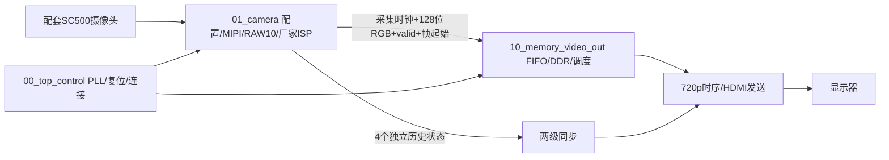

# 架构与接口

三个目录包含真实可综合模块，功能通过实例连接。厂家IP留在 `user_source`，没有为迁就目录分类移动依赖。基础彩色转换属于摄像头链路的一部分，并不表示独立 `02_image_preprocess` 或 `08_lighting_isp` 扩展已完成。

## 摄像头到缓存边界

| 信号 | 含义及项目流约定对应 |
|---|---|
| `O_capture_clk` | 厂家CSI接收时钟，下游写FIFO使用此时钟 |
| `O_rgb128[127:0]` | 打包的RGB字节流，对应多像素数据，不能直接视为一个 `pixel` |
| `O_data_valid` | 128位字有效，对应该打包协议的 `valid` |
| `O_frame_start` | 厂家ISP打包链路帧起始，对应帧边界事件；不是每像素接口，不要求与首个128位valid同拍 |
| `eol` | 边界未提供可靠行尾；ISP的 `O_tlast` 未与96→128位打包对齐，故不导出 |
| `frame_id` | 未提供；后续逐像素处理接口需另行建立与验证 |

RAW10适配器每拍4个10位像素；厂家ISP形成96位RGB，随后每4个96位字变成3个128位字（16个RGB888像素）。字节流从高位向低位排列，128位边界可能切开24位像素。正常每行320个连续96位有效输入形成240个128位有效输出，即1280×3字节；每帧172800个128位字、2764800字节。显示读出按16像素一组从3个128位字恢复24位像素，RGB各通道的实物颜色仍需色卡确认。

摄像头不能任意暂停；没有下游ready反压。跨时钟数据仍经厂家FIFO和DDR，未改为多位逐位同步。连续行内有效节拍是现有打包器的前提：其无效拍会清打包计数，不能把RAW适配器可接受valid间断推论为整个RGB打包链路可接受任意间断。

## 缓存及显示

沿用厂家四个缓冲区基地址0、7000000、14000000、21000000（DDR用户接口地址单位，不直接当作字节）。每128位事务地址加8；每行240个事务。读写调度、帧开始展宽与指针轮换保留。它不是完整帧提交握手协议，不能据此保证异常情况下不撕裂或不显示未完成帧。

HDMI有效1280×720，总1650×750；水平同步区1390～1430，垂直725～730。默认0摄像头；1彩条用于显示端检查；3显示四段历史诊断状态。HDMI发送保留原RGB输入路径，音频与EDID读取未启用，不会根据显示器自动改分辨率。

## 时钟与复位

| 对象 | 本次保留设置 |
|---|---|
| 板级参考 | 50 MHz，20 ns约束 |
| 控制时钟 | 100 MHz |
| 摄像头参考 | 理论23.809524 MHz；名称中的24m不是精确频率 |
| HDMI像素/串行 | 75 / 375 MHz；理论刷新率75,000,000/(1650×750)=60.6060606 Hz |
| MIPI输入 | 外部约束4.167 ns，约239.981 MHz；派生字节时钟约59.995 MHz，非实测 |
| DDR | 厂家IP时钟及约束，详见实际时钟报告 |

PLL仍位于顶层 `u_PLL`；MIPI/DDR层级分别新增 `u_camera/`、`u_video/`，SDC同步更新。STA工具因周期舍入可能显示75.002MHz，不应据此称为精确实测频率。各异步时钟组保持基线设置。

外部低有效复位控制PLL，整体逻辑复位沿用PLL lock，未新增全链路复位释放同步。这是基线兼容选择，不能宣称已完成跨时钟复位安全验证。只有四个独立诊断位新增两级同步，不用它传图像、坐标或多位一致性数据。

状态位0=曾完成配置；1=曾收到高速数据；2=已观察重复CSI帧起始；3=曾观察400个32位CSI有效字的一行（对应1280 RAW10像素）。均为置位保持的历史信息，不反映实时帧率、停流、CRC或持续健康状态。
