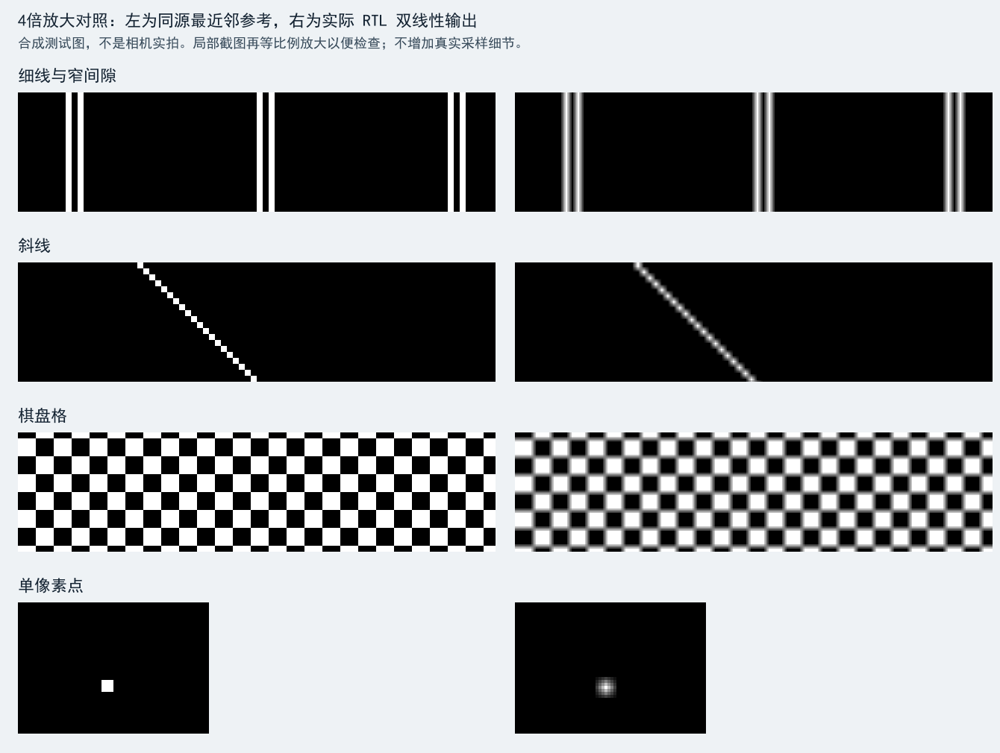

# ImproveFourfoldScale 软件验证与构建报告

完成日期：2026-10-06；TD构建日期：2026-10-05。分支ImproveFourfoldScale，起点main `4c2620782e7f29367620975b51e850a34f846ef1`。**软件验证与TD构建通过；未上板、未下载、未烧Flash。**

仅原图、灰度的4倍缩放采用双线性；其他组合保留最近邻结果。按键及OSD不增加功能。main和旧bit保留，未推送或合并本分支。

## 验证结果

| 项目 | 结果与证据 |
|---|---|
| 算术与同步 | 66,052次检查；16个小数位置、黑白极值组合、常量、确定性随机RGB、无效像素、复位和两级同步；独立加权整数模型逐通道核对 |
| 完整视频 | 30组、36个完整帧，1650×750总节拍；核对28,753,920个视频区像素及十二级同步延迟 |
| 保持原结果 | 1/2倍四模式、4倍边缘/二值化；独立最近邻坐标模型加main存档提取的原处理模块核对；不是全工程形式等价证明 |
| 插值与边界 | 原图/灰度、四角、最大窗口起点、959/563及13/37非对齐起点、随机/常量/渐变/细线/间隙/斜线/点/棋盘格；跨16像素组、行尾和底栏边界 |
| 并发与欠载 | 模拟持续相机写请求、写最后一拍、DDR命令等待/延迟响应；两类故障后恢复，无读写所有权重叠 |
| 帧提交 | 帧中改变窗口/倍率/DDR基址，以及原始VS与延迟VS之间改变模式；本帧参数不混用，下一帧生效 |
| 有效画面中复位 | 独立测试通过；清空模型响应队列并同步重启，核对重启后一个完整4倍灰度帧798,720像素；不证明仅复位局部逻辑而保留DDR在途事务的恢复 |
| 控制 | 原消抖、方向锁定、增益跨域/上下限、长按、多键冲突、四边/倍率、窗口与模式原子提交通过 |
| OSD | 六幅完整帧、5,529,600像素与独立布局模型一致；准心/文字/Logo源码与main相同 |
| 原处理算法 | 开关、小图、720p大图三组回归通过；大图3,688,960像素 |
| 来源与构建审计 | 厂家来源、Lab3引用、OSD素材、main旧bit及旧日志保持；66个工程依赖、约束、构建输入和bit哈希通过 |

完整日志：[视频/运算/控制](fourfold_simulation.log)、[复位](fourfold_reset_simulation.log)、[OSD](fourfold_osd_simulation.log)、[算法回归](fourfold_preprocess_simulation.log)、[审计](fourfold_audit.json)。包括复位后完整帧共37帧、29,552,640视频区像素；复位前部分帧不计入该完整帧总数。

首次全量测试29组通过，动态模式测试中的局部OSD检查错误地使用初始模式，灰度切换后仍与彩色参考比较，产生误报。已改为实际生效模式并新增灰度点检查，重新运行完整30组和复位测试通过；失败日志保留为 `fourfold_first_simulation.log`，不作为最终通过证据。此次修正只涉及测试，未改变已构建RTL。

随后收紧欠载断言，取消旧测试对头两个无效像素的宽容条件；使用最终测试源码对两类DDR延迟故障单独再跑5帧，逐像素通过。证据见 [严格欠载边界复测](fourfold_fault_simulation.log)，额外重复的5帧未计入上述37帧总数。最终全量入口同样使用该严格断言；正常画面与复位测试的比较逻辑不受这项收紧影响。

DDR为有序返回队列与竞争模型，不是MIPI/DDR物理接口仿真。参考像素和插值整数模型独立计算；原处理源码用于对照不变算法。OSD参考模型使用存档ROM点阵，因此不构成独立字形设计证明。

## 最终构建

TD6.2.168116，PH1P35MDG324 −3。建立/保持时间结果：

```text
SWNS: 1.233ns, STNS: 0.000ns.
HWNS: 0.020ns, HTNS: 0.000ns.
```

| 资源 | main | 本版本 | 增量 |
|---|---:|---:|---:|
| LUT6 | 11,449 | 12,189 | +740 |
| 寄存器 | 14,220 | 14,445 | +225 |
| Slice | 13,864 | 14,600 | +736 |
| ERAM20K | 50/108 | 80/108 | +30 |
| DSP | 10/40 | 10/40 | +0 |

STA覆盖率96.61%，不是100%；约束内容与main一致，没有新增或放宽例外。原增益三个首级跨域例外、厂家约束限制和原链路警告仍存在。RAM增长来自四行/四读副本；新增插值移位加法不占额外DSP。正余量不等于全路径和整个跨域协议均已证明。

构建不是零警告：TD对现有风格的 `ram_style="block"` 提示按AUTO推断，最终资源报告确认使用80个ERAM；相机/I²C混合时钟负载、局部时钟布线和厂家DDR未驱动引脚等警告保留在日志中，未通过新增例外掩盖。IP的18条最大延迟约束受既有时钟分组覆盖，也见时序例外报告。

新bit：`build/improve_fourfold_scale/improve_fourfold_scale.bit`，长度1,789,537字节，SHA256：

```text
979e1c92de9ca899f3cd798abbd5fcba51746dd2fd2a4aa33366618ec1c1f393
```

构建证据：[输入与bit清单](fourfold_build_manifest.json)、[构建日志](fourfold_build.log)、`build/improve_fourfold_scale/`内时序/资源报告。源码格式按原换行约定整理后重新构建，清单对应最终文件。

旧main bit仍为 `a598cff3ea804c0fbc9e54d1693e03cfc32fa4b9aef2d7133f234879dc6edf8c`，未覆盖。独立构建输出与旧审计均保留。

## 图像对照与实物边界



左侧是相同合成源图的main最近邻坐标参考，右侧来自新RTL仿真输出，局部截图放大便于观察；完整图、源图和截取位置/哈希见该目录。不是相机实拍。对照同时展示方块平滑和局部对比度变化，不能称为新增真实细节。

操作、来源和上板流程见[使用与实现](../docs/ImproveFourfoldScale使用与实现.md)。未实现自动跟踪/双色检测/尖端标定/准心隐藏；旧采集打包复位及坏帧隔离暂缓。端到端延迟、真实帧率、连续稳定性与实物画质均待测。

---

## 2026-10-06 首次上板 A/B 实物验收（使用者 实测）

对象：`build/improve_fourfold_scale/improve_fourfold_scale.bit`，SHA256
`979e1c92de9ca899f3cd798abbd5fcba51746dd2fd2a4aa33366618ec1c1f393`；
对照：`build/scaling_test/scaling_test.bit`（已验收）`a598cff3ea804c0fbc9e54d1693e03cfc32fa4b9aef2d7133f234879dc6edf8c`。
测试环境：HX1P35A V1.0（丝印 2025-04-14）、摄像头模组 MLK-CAM001 V1.0（SC500CS）、显示器 KTC H25T7；
仅 SRAM 在线下载，未烧写 Flash。

| 验收项 | 结果 | 依据 |
|---|---|---|
| 4× 原图/灰度双线性生效（方块感消除） | **通过** | 同机位 A/B：边缘过渡宽度 17 → 25 像素（≈1.5×） |
| **细线/窄缝仍可辨** | **通过** | 同机位 A/B：窄缝平均深度 0.71 vs 0.71（无下降）；缝 1/2/3/4/6px 五组均可解析 |
| 1× / 2× 全部模式未受影响 | **通过** | 照片无可辨差异；RTL 上零权重走同一流水线 |
| 4× 边缘 / 二值化未受影响 | **通过** | 轮廓结构一致；RTL 旁路插值 |
| 无过冲 / 振铃 | **通过** | 算法保证（输出必在四邻域 min/max 之间），照片无黑晕亮晕 |
| 准心 / OSD / 坐标 / 倍率 / 中文 / Logo | **通过** | 14 张照片读数一致且正确 |
| 按键 / 增益 / 动态与稳定性 | **通过** | 第 4、5 步现场确认，与 ScalingTest 一致 |
| 30 分钟连续运行 | **未执行** | 按决定不作为前置条件 |
| 4× 二值化"白级"覆盖 | **未覆盖** | 两次取样窗口均落在暗区（全黑），白级未被验证；按决定不再补测 |

**量化方法**：以手持照片中"最强对比行"的均值剖面为测量对象；边缘过渡宽度取 10%→90% 跨越像素数，
窄缝深度取缝底相对满对比的比例。**注意**：最初那组 4× 照片（1×/2× 与 4× 混合拍摄）机位/对焦有变化，
本应完全相同的"4× 边缘"两组指标相差约 1.8 倍，因此该组只作定性判断；
本节的量化结论仅采用**同机位的细缝 A/B 一对**（证据图：`reports/improve_fourfold_ab/细缝可辨性对比_旧bit_vs_新bit.png`）。

**结论：ImproveFourfoldScale 首次上板验收通过**，画质目标达成（方块感消除）且未牺牲细线/窄缝可辨性，
**说明**：该版本的 RTL 与 bit 已归档在 `ImproveFourfoldScale` 分支（`86ef777`）；本分支归档说明文档与验收结论，未合并 main。
本仓库归档的是说明文档与验收结论。
