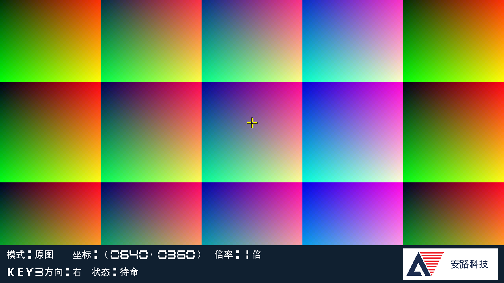
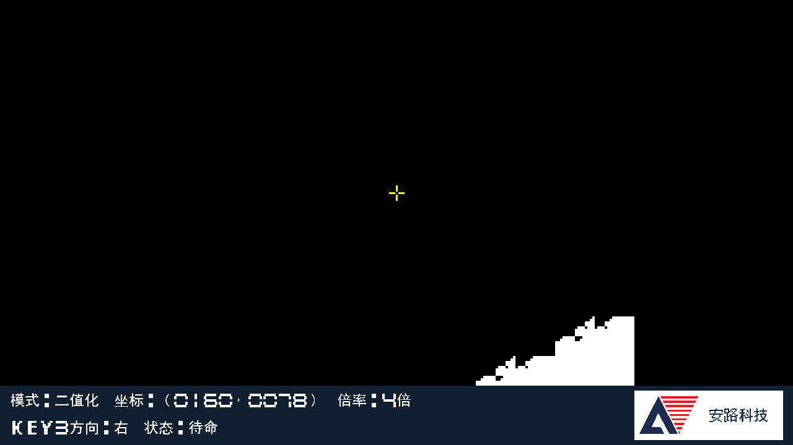

# ScalingTest 软件验证与构建报告

日期：2026-10-05。分支 `ScalingTest`，起点 `main e6716302725f68d6e9af176d04a493d500a54e66`；开发前重新获取远端，本地主干与远端一致，保留了已有Logo素材与方案文档。**软件验证完成，实物验收待测。未下载板卡、未烧Flash。**

## 结果

| 项目 | 结果与证据 |
|---|---|
| 控制与窗口 | 通过；消抖、四方向短按、长按加速、锁定方向、多键冲突恢复、复位时按住、增益16/105上下限和跨时钟请求、倍率上下限、四边选点、帧提交、缩回1倍保留坐标 |
| 缩放与完整节拍 | 15组、共19帧通过，1650×750节拍、约75MHz像素域/66.667MHz DDR域；独立坐标模型核对15,175,680个视频区像素及每拍VS/HS/DE |
| 边界与并发 | 包含1/2/4倍、非16像素对齐横向起点13及959、靠近底部的行、跨128位字、每行最后16像素；DDR间歇不接收命令、连续写突发竞争、写最后一拍互斥、响应延迟均覆盖 |
| 帧变更 | 帧中途同时更新窗口、倍率和可用DDR读缓存区，本帧仍使用旧参数/缓存，下一帧使用新参数/缓存；通过 |
| 欠载恢复 | 两类延迟注入通过，分别造成732,160和814,080个黑色视频区像素；后者跨显示帧，确认旧响应未混入新帧，最后一帧恢复 |
| OSD | 六幅完整输出与独立文字/布局模型逐像素比较，5,529,600像素全部一致；覆盖四模式文字、0/1279与0/719坐标、1/2/4倍、四方向、五状态、Logo色值、准心四角裁剪 |
| 原四模式回归 | 三组通过；开关、17×9小图、1280×720大图。大图独立RGB/Sobel/灰度/二值化参考比较3,688,960个有效像素，原算法源码未改 |
| 依赖与来源审计 | 通过；193文件Lab1基线及厂家工作副本已登记哈希保持，4份Lab3原始文件保持，65个工程依赖有效，6个RTL目录参与综合，新增引脚/ROM/bit哈希核对 |
| TD 6.2.168116 | PH1P35MDG324 −3：综合、布局布线、bit生成完成 |
| 实物验收 | 未执行；SW3/SW4上下极性、真实相机连续读写、屏幕文字清晰度、全部按键与倍率待板上检查 |

日志：[缩放与控制](scaling_simulation.log)、[OSD](scaling_osd_simulation.log)、[原算法回归](imagepreprocess_10_3_simulation.log)、[构建](scaling_test_build.log)、[审计](scaling_audit.json)。入口见 [使用与实现说明](../docs/ScalingTest使用与实现.md)。

仿真中的DDR是有序响应队列和等待模型，不是DDR物理接口模型；连续写竞争按现有 `video_in` 的所有权和寄存最后一拍行为建模，没有运行真实相机/MIPI/DDR PHY。控制测试压缩毫秒计数器以缩短仿真，真实RTL默认为每毫秒75,000拍。OSD测试使用实际生成ROM的点阵内容对照独立字符串与坐标组合，因此检查文字选择/布局，不构成字体设计独立验证；另人工查看输出图核对清晰度。

## 最终构建

| 指标 | 最终值 |
|---|---:|
| 建立时间最差余量 SWNS | +1.064 ns |
| 建立时间负余量总和 STNS | 0.000 ns |
| 保持时间最差余量 HWNS | +0.020 ns |
| 保持时间负余量总和 HTNS | 0.000 ns |
| STA 覆盖率 | 96.36% |
| LUT6 | 11,449 / 21,216（53.96%） |
| 寄存器 | 14,220 / 42,432（33.51%） |
| Slice | 13,864 / 21,216（65.35%） |
| ERAM20K | 50 / 108（46.30%） |
| DSP | 10 / 40（25.00%） |

原四模式报告40块RAM，本次净增10块；新行缓存实例使用10块，OSD共4块，同时移除了旧显示读FIFO等资源，所以不能把实例资源直接相加作为净增量。没有新增全帧片上缓存。资源以布线后报告为准，综合中间估计不同。

原有时钟关系和IP约束保留。增益请求新增三个限定到首级同步寄存器的跨域例外（req1、up1、ack1），其余同步级和域内路径继续分析；没有把全部像素/摄像头配置时钟间路径统一忽略。原IP报告仍有18条最大延迟约束被原异步时钟分组覆盖；覆盖率不是100%，因此“余量为正”只代表当前约束范围内通过，不是全部路径已证明。

第一次构建发现增益跨域直连方向/应答路径建立违例，SWNS −1.784ns。随后增加方向同步、延迟请求消费与局部约束，最终通过；初次失败报告保留为 `scaling_first_scaling_test_*`，不是当前bit证据。复查还修正了写最后一拍期间的读机会预留，避免持续写入时读端饥饿，并用持续写竞争重新跑完新增视频测试和最终构建。

最终 [bit](../build/scaling_test/scaling_test.bit) SHA256：

```text
a598cff3ea804c0fbc9e54d1693e03cfc32fa4b9aef2d7133f234879dc6edf8c
```

长度1,789,537字节。参与构建文件的SHA256见 [构建输入清单](scaling_build_manifest.json)，时序与资源原件保存在 `build/scaling_test/`。原四模式bit仍为 `eddd9d7d28eb431de92d1d0f061962645b7734b027469290ae06166c9183ddf9`，未覆盖。

## RTL仿真预览

下列是测试图经硬件描述代码仿真得到的输出，不是实拍摄像头画面：






其余模式、倍率与OSD状态预览保存于同目录。没有用示意图替代RTL输出。

## 边界与后续实测

本轮只保证新增显示链路的欠载隔离和重试；未解决旧相机打包复位、输入坏帧隔离、旧四缓冲在任意帧率/异常下的完整管理，也没有新增可靠相机frame_id/eol。旧 `video_out.v` 保留但不在新显示路径中，因此旧尾字缺陷不应误报为“厂家旧模块已修好”。旧诊断彩条的DEBUG_MODE不控制新缩放显示路径。

尚未实测光到光延迟、相机真实帧率、长时间稳定性、换屏兼容性；此前跳过的30分钟测试不重新设为开发前置条件。软件完成与实物验收分别记录，主干旧bit四模式已验收不等于本bit已验收。
